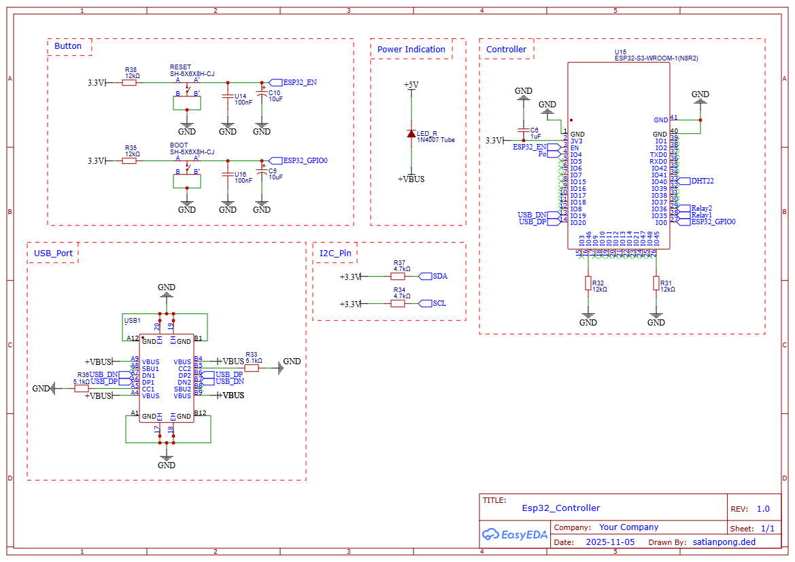
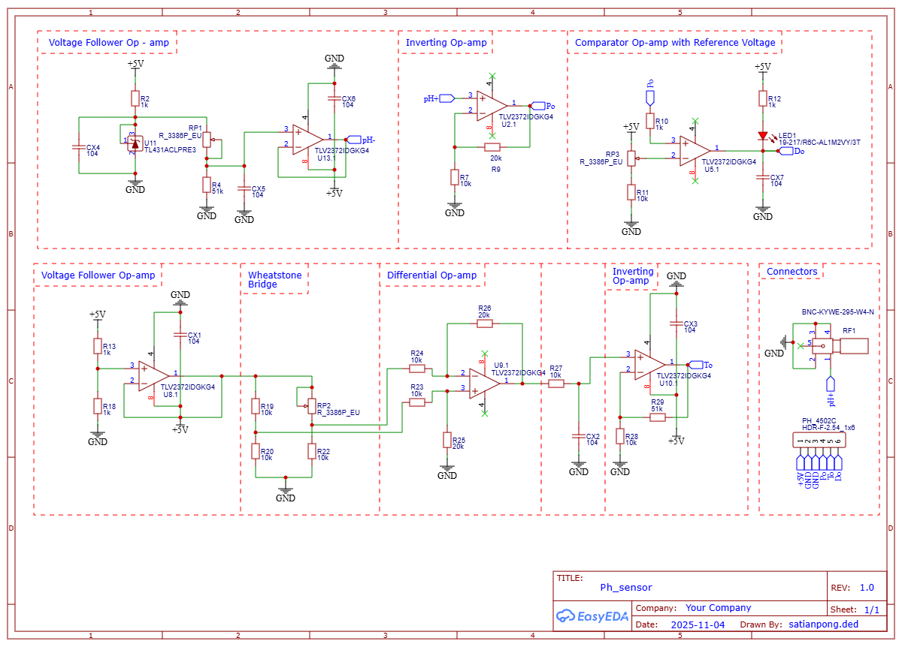
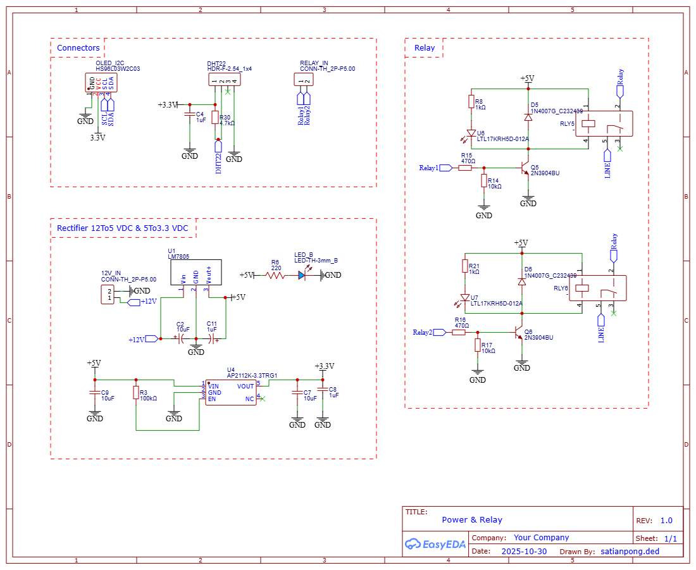
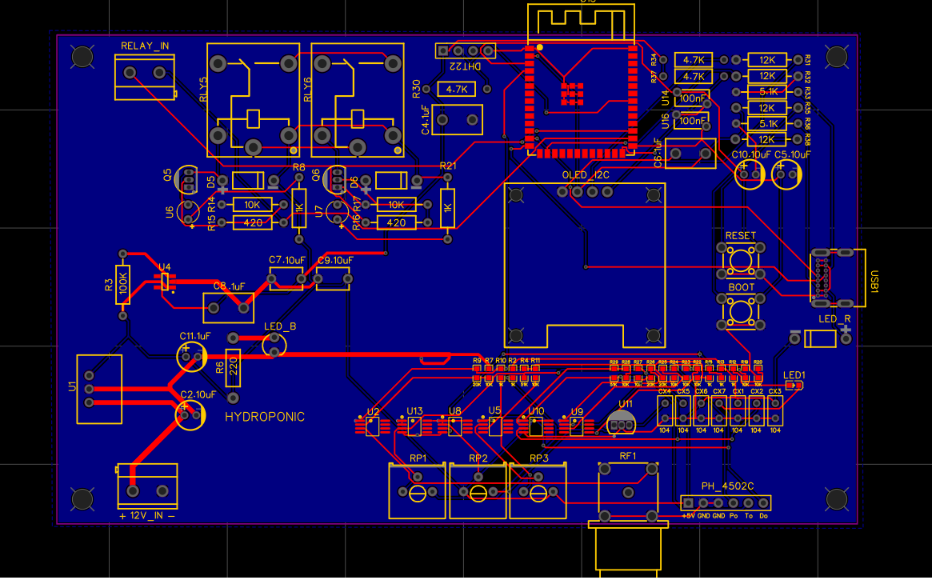
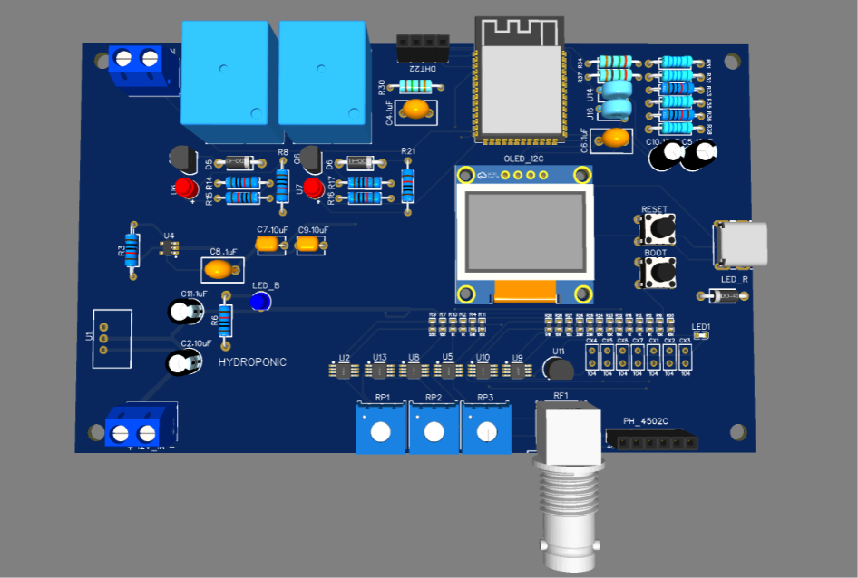

# Hydroponic_PCB

A custom PCB for controlling a hydroponic system, built around the **ESP32-S3**. It measures **pH**, **temperature** and **humidity**, shows readings on an OLED display, publishes telemetry to **ThingsBoard** over MQTT, and drives water pumps through two relays, either on an automatic timer or by remote command.

Designed in **EasyEDA** by satianpong.ded (REV 1.0).

---

## Features

- **pH measurement** through an analog front-end (TLV2372 op-amps) with a Wheatstone bridge and a comparator for threshold alerts
- **Temperature / humidity** sensing with a DHT22
- **OLED (SSD1306, I2C)** local display
- **ThingsBoard** telemetry over MQTT, with remote control through RPC
- **Two relay channels** (Relay1, Relay2) for pumps or other loads
- Onboard power chain: 12 V -> 5 V (LM7805) -> 3.3 V (AP2112K)
- **USB-C** for programming and power
- **RESET** and **BOOT** buttons

---

## Schematics

The design is split into three sheets. Full-size images are in the [`Schematic/`](Schematic) folder.

### 1) `Esp32_Controller` (2025-11-05)

| Block | Description |
|---|---|
| Controller | ESP32-S3-WROOM-1 (N8R2) |
| Button | RESET (EN) and BOOT (GPIO0) buttons with 12 kΩ pull-ups and 100 nF / 10 µF debounce capacitors |
| USB_Port | USB Type-C (USB1) with 5.1 kΩ resistors on CC1/CC2, D+/D- wired to the ESP32-S3 |
| I2C_Pin | 4.7 kΩ pull-ups on SDA / SCL to 3.3 V |
| Power Indication | LED showing the 5 V rail is live |

### 2) `Ph_sensor` (2025-11-04)

Analog front-end for pH and temperature sensing, using **TLV2372IDGKG4** dual rail-to-rail op-amps.

| Block | Function |
|---|---|
| Voltage Follower (top) | Reference voltage from a **TL431**, adjustable with RP1, buffered as `pH-` |
| Inverting Op-amp (top) | Takes `pH+` from the BNC probe connector and produces the **Po** signal |
| Comparator + Reference | Compares Po against an adjustable reference (RP3); drives an LED and the digital output **Do** |
| Voltage Follower (bottom) + Wheatstone Bridge | Supplies the bridge reference; balanced with RP2 |
| Differential Op-amp | Amplifies the bridge difference |
| Inverting Op-amp (bottom) | Final gain stage, producing the **To** signal |
| Connectors | BNC (RF1) for the pH probe; 1x6 header: `+5V, GND, GND, To, Po, Do` |

### 3) `Power & Relay` (2025-10-30)

| Block | Description |
|---|---|
| Rectifier / Regulator | 12 V DC -> **LM7805** -> 5 V -> **AP2112K-3.3** -> 3.3 V, with a status LED on the 5 V rail |
| Connectors | OLED (I2C), DHT22 (4.7 kΩ pull-up), RELAY_IN, 12V_IN (CONN-TH 2P 5.00) |
| Relay x2 | Driven by **2N3904** transistors (470 Ω base resistors), **1N4007** flyback diodes, status LEDs, and a LINE terminal for the load |

---

## Pin Mapping

Net names to ESP32-S3 GPIO numbers, per the Controller sheet. The firmware uses these same GPIO numbers.

| Signal | ESP32-S3 pin | Notes |
|---|---|---|
| `Po` (pH) | IO4 | Analog input |
| `SDA` / `SCL` | IO8 / IO9 | I2C for the OLED (address 0x3C) |
| `DHT22` | IO40 | |
| `Relay1` | IO35 | Active-HIGH (NPN driver) |
| `Relay2` | IO36 | Active-HIGH (NPN driver) |
| `USB_DP` / `USB_DN` | IO20 / IO19 | USB-C |
| `ESP32_GPIO0` | IO0 | BOOT button |

---

## Bill of Materials (main parts)

The complete list is in [`Hardware/BOM_Hydroponic.csv`](Hardware/BOM_Hydroponic.csv).

| Part | Description |
|---|---|
| U15 | ESP32-S3-WROOM-1 (N8R2) |
| U2.1, U5.1, U8.1, U9.1, U10.1, U13.1 | TLV2372IDGKG4 (op-amp) |
| U11 | TL431ACLPRE3 (voltage reference) |
| U1 | LM7805 |
| U4 | AP2112K-3.3TRG1 |
| Q5, Q6 | 2N3904 |
| D5, D6 | 1N4007 |
| RLY5, RLY6 | Relay |
| RP1, RP2, RP3 | R_3386P_EU (3386P trimmer) |
| RF1 | BNC-KYWE-295-W4-N |
| USB1 | USB Type-C |
| Other | DHT22, SSD1306 128x64 I2C OLED, 2.54 mm headers, resistors and capacitors per the schematics |

---

## Hardware / Manufacturing

All files are in the [`Hardware/`](Hardware) folder.

| File | Purpose |
|---|---|
| [`Gerber_Hydroponic.zip`](Hardware/Gerber_Hydroponic.zip) | Fabrication files for the bare PCB (JLCPCB, PCBWay, etc.) |
| [`BOM_Hydroponic.csv`](Hardware/BOM_Hydroponic.csv) | Full parts list, for sourcing or assembly |
| [`PickAndPlace_PCB.csv`](Hardware/PickAndPlace_PCB.csv) | Component coordinates and rotation, for SMT assembly services |
| `PCB_layout.png` | PCB layout image |
| `3D_img.png` | 3D render of the board |

**Bare board only:** upload `Gerber_Hydroponic.zip` to the fab and solder the parts yourself using the BOM.
**Assembled by the fab:** provide all three files: Gerber + BOM + Pick & Place.

### PCB Layout

### 3D Preview

---

## Firmware

Source: [`Firmware/Hydroponic_Project.ino`](Firmware/Hydroponic_Project.ino)

### Required libraries (Arduino IDE / PlatformIO)

- `PubSubClient`
- `DHT sensor library` (Adafruit)
- `Adafruit GFX Library`
- `Adafruit SSD1306`

Board: **ESP32S3 Dev Module** (esp32 core by Espressif)

### How it works

1. Connects to Wi-Fi, then to MQTT at `demo.thingsboard.io` (port 1883) using the Access Token as the username. Reconnection is non-blocking, so the pump timer keeps running if the network drops.
2. Reads pH (averaged over 16 samples), temperature and humidity every second and shows them on the OLED. If a DHT22 read fails, the last good value is kept.
3. Publishes JSON telemetry to `v1/devices/me/telemetry` every 5 seconds.
4. Runs Relay1 (pump) on an automatic cycle: **ON for 10 s out of every 15 s**.
5. Accepts remote commands from ThingsBoard (see RPC methods below). A manual command on Relay1 suspends the automatic timer until `setAuto` is received.

### Configuration

Edit these values at the top of the `.ino` file before uploading:

| Variable | Description |
|---|---|
| `WIFI_SSID`, `WIFI_PASS` | Wi-Fi credentials |
| `TB_TOKEN` | ThingsBoard device Access Token |
| `PH_V_NEUTRAL`, `PH_SLOPE` | pH calibration constants |
| `PUMP_CYCLE_MS`, `PUMP_ON_MS` | Pump cycle length and ON time |
| `PUBLISH_INTERVAL` | Telemetry interval |

Do not commit real credentials to a public repository.

---

## ThingsBoard Setup

1. Create a device on [ThingsBoard](https://demo.thingsboard.io) and copy its **Access Token**.
2. Put the token in the `TB_TOKEN` variable.
3. Telemetry keys sent: `ph`, `temperature`, `humidity`, `relay1`, `relay2`.
4. Build a dashboard with charts / gauges as needed, and add switch widgets that call the RPC methods below.

### RPC methods

The firmware subscribes to `v1/devices/me/rpc/request/+` and replies with the current relay state.

| Method | Params | Effect |
|---|---|---|
| `setPump` or `setRelay1` | `true` / `false` | Turns Relay1 on or off and switches to manual mode |
| `setRelay2` | `true` / `false` | Turns Relay2 on or off |
| `setAuto` | any | Returns Relay1 to the automatic timer |

Example request body: `{"method":"setPump","params":true}`

Plain-text `ON` / `OFF` messages are also accepted for Relay1.

---

## Before First Use

- **Calibrate pH:** `PH_V_NEUTRAL` and `PH_SLOPE` are approximate defaults. Calibrate with standard buffer solutions (for example pH 4.0 and 7.0) and update them.
- **Check the Po voltage:** the pH op-amps run from 5 V, so the Po output can exceed the 3.3 V limit of the ESP32-S3 ADC. Measure Po with a multimeter before connecting it to the ESP32, and add a voltage divider if needed.
- **Relay logic:** the relay driver is an NPN 2N3904, so a HIGH GPIO turns the relay on. The firmware is written for this (`RELAY_ON = HIGH`). If you replace the driver with an active-LOW relay module, change `RELAY_ON` / `RELAY_OFF`.
- **Safety:** the relay LINE terminals can switch mains voltage. Use proper insulation and creepage distances.

## License

MIT License (change as needed)
